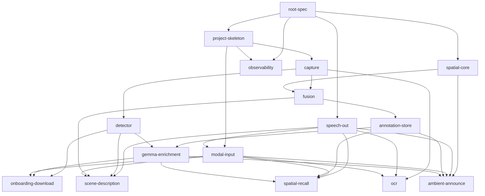

# EchoSight AVP — Spec Manifest

**Project:** EchoSight on Apple Vision Pro (v0.1)
**Created:** 2026-04-21
**Mode:** spec-driven
**Priority:** Quality
**Project Type:** Greenfield
**Source:** `EchoSight-AVP-Brainstorm.md` (2026-04-11)
**Review:** CEO (Scope Expansion) completed 2026-04-21

## Goal

Ship a visionOS v0.1 accessibility app: always-on Layer 1 spatial awareness + four user-accessible surfaces (scene / recall / read / silent via Crown-cycles-modes) + passive ambient announce on room entry, with persistent cross-session spatial memory. Fully local inference, privacy-preserving.

## Key Decisions (Gate 1-3 + CEO Review)

- **Detector:** `Detector` protocol. v0.1 ships Vision placeholder (`VNRecognizeObjectsRequest` / Core ML YOLO). Falcon-Perception mlx-swift port lands post-v0.1.
- **Voice:** deferred to v1.0. v0.1 is zero-voice — no WhisperKit, no keyword spotter.
- **Feature set v0.1:** Expanded from "Feature 1 only" to **four surfaces** — scene description, spatial recall, OCR read, ambient announce. All non-voice.
- **Input model:** Crown-cycles-modes + Button-fires-current-mode. Modes: scene / recall / read / silent.
- **OCR:** restored to v0.1 via `VNRecognizeTextRequest` (zero model-download cost, ~2-3 days of work, table-stakes BLV feature).
- **Spatial recall:** 1st press = Gemma room gestalt; 2nd press within 5 s = top-N nearest annotations.
- **Ambient announce:** world-anchor novelty → spatial chime always; full speech only on cold anchor (unseen >30 min) AND idle user (no gesture in last 5 min).
- **Model download:** all ~2.6 GB at first launch (Vision/YOLO + WhisperKit-dormant + Gemma 4 E2B).
- **FOV calibration:** dev-only debug scene inside `fusion-spec`. No user-facing re-calibration.
- **Gemma:** single instance serves three consumers (async enrichment + sync recall summarize + sync ambient room-label) via priority queue with preemption.
- **Annotation store:** expanded from write-only to read/write with new `AnchorMetadata` table (last-seen, visit count, user/inferred labels).
- **Layer 1 as standalone alpha:** `spatial-core` shippable on its own as v0.0.1 (obstacle audio cues + head pose, no ML).

### Additions from Eng Review (2026-04-21)
- **Speech ownership:** single `SpeechOut` actor owns the sole `AVSpeechSynthesizer`. Two priority slots (`.high` / `.normal`). `.high` preempts `.normal`; `.normal` drops if `.high` is live. Silent-mode gate inside `SpeechOut` for `.normal`; ambient-announce owns silent-mode policy for `.high`.
- **Recall state home:** `spatial-recall` owns the 2-press state machine and 5-s timer. `modal-input` is pure event publisher (no per-mode state). Recall subscribes to both `ModeFiredEvent` and `ModeChangeEvent` to self-abort.
- **Ambient idle:** idle = (no `ModeFiredEvent` in 5 min) AND (head-pose variance >threshold over last 30s). Chime always plays; speech additionally gated by this compound idle rule.
- **Anchor rehydration:** `.rerecognized` event triggers eager silent load into spatial hash. No user-facing speech from rehydration itself — ambient-announce's cold-anchor path is the user-facing "welcome back."
- **Observability:** `DebugConsoleView` + 15-category swift-log taxonomy + metrics ring buffer + log export. Every feature spec gains an Observability subsection.
- **Onboarding tutorial:** non-gating. Skip button is first VoiceOver focus target from tutorial entry. Hardware diagnostic lives in Settings.

## Dependency DAG

## Phase / Sprint Map

| Phase | Sprint | Specs | Parallelizable |
|-------|--------|-------|----------------|
| 1 | 1 | root, project-skeleton, spatial-core, speech-out, observability | yes (5 independent foundations; skeleton wires observability bootstrap) |
| 1 | 2 | capture | no (single spec) |
| 2 | 1 | detector, fusion | yes |
| 2 | 2 | modal-input, scene-description, ocr | yes (modal-input first, then scene + ocr parallel) |
| 3 | 1 | annotation-store, gemma-enrichment | partial (gemma needs annotation API) |
| 3 | 2 | spatial-recall, ambient-announce, onboarding-download | partial (recall + ambient parallel; onboarding last) |
| 4 | 1 | backlog-codereview | no (single consolidation spec) |
| 4 | 2 | backlog-hig-warnings | no (single consolidation spec) |
| 4 | 3 | quality-audits | no (single consolidation spec) |

## Spec Files

| Spec | Path | Phase | Sprint | Status | Approx LOC spec | Role |
|------|------|-------|--------|--------|-----------------|------|
| root | specs/root-spec.md | 1 | 1 | eng-reviewed | 230 | Project-wide decisions + surface map |
| project-skeleton | specs/project-skeleton-spec.md | 1 | 1 | eng-reviewed | 140 | Xcode / SPM scaffold + observability bootstrap |
| spatial-core | specs/spatial-core-spec.md | 1 | 1 | eng-reviewed | 230 | Layer 1 + anchor event stream + head-pose variance |
| speech-out | specs/speech-out-spec.md | 1 | 1 | tla-verified | 210 | Single AVSpeechSynthesizer owner + priority + ducking (NEW) |
| observability | specs/observability-spec.md | 1 | 1 | eng-reviewed | 220 | swift-log categories + metrics ring + DebugConsoleView (NEW) |
| capture | specs/capture-spec.md | 1 | 2 | eng-reviewed | 160 | PeekABoo-backed capture source |
| detector | specs/detector-spec.md | 2 | 1 | eng-reviewed | 150 | Vision/YOLO detector behind protocol |
| fusion | specs/fusion-spec.md | 2 | 1 | eng-reviewed | 200 | 2D->3D + label reconciliation + main-actor raycast |
| modal-input | specs/modal-input-spec.md | 2 | 2 | completed | 180 | Crown-cycles-modes + Button-fire event bus |
| scene-description | specs/scene-description-spec.md | 2 | 2 | completed | 210 | Scene mode pipeline (binds speech-out) |
| ocr | specs/ocr-spec.md | 2 | 2 | completed | 210 | Read mode via VNRecognizeTextRequest |
| annotation-store | specs/annotation-store-spec.md | 3 | 1 | eng-reviewed | 250 | Annotations + anchor metadata + rehydrator |
| gemma-enrichment | specs/gemma-enrichment-spec.md | 3 | 1 | eng-reviewed | 280 | Three-consumer priority queue + preemption cadence |
| spatial-recall | specs/spatial-recall-spec.md | 3 | 2 | completed | 200 | Recall state machine (owns 2-press timer) |
| ambient-announce | specs/ambient-announce-spec.md | 3 | 2 | completed | 240 | Passive announce (idle = gesture + head-motion) |
| onboarding-download | specs/onboarding-download-spec.md | 3 | 2 | completed | 190 | 2.6 GB download + non-gating tutorial + diagnostic |
| backlog-codereview | specs/backlog-codereview-spec.md | 4 | 1 | eng-reviewed | 150 | Phase 1–3 P2/P3 code-review backlog cleanup (23 items) |
| backlog-hig-warnings | specs/backlog-hig-warnings-spec.md | 4 | 2 | eng-reviewed | 110 | HIG P2/P3 deferrals + Sprint 3.2 build-warning cleanup |
| quality-audits | specs/quality-audits-spec.md | 4 | 3 | eng-reviewed | 120 | /test-review + /perf-review + P0/P1 audit fixes |

Total specs: **19** (16 feature specs across Phases 1–3 + 3 housekeeping specs in Phase 4). New specs from eng review: speech-out, observability. New specs from Phase 4 planning (2026-04-22): backlog-codereview, backlog-hig-warnings, quality-audits.

## Success Criteria (v0.1)

- Layer 1 runs all-day (negligible power, no ML).
- Gesture capture in scene mode -> scene description spoken in <=1.5 s (fast path).
- Crown rotation cycles 4 modes with audible confirmation.
- Recall mode: 1st press speaks Gemma gestalt within 2 s; 2nd press within 5 s speaks top-N detail list within 800 ms.
- Read mode: VNRecognizeTextRequest capture -> text TTS within 1.5 s p95.
- Ambient announce fires chime on world-anchor novelty within 200 ms; full speech fires only on cold + idle conditions.
- Annotations persist across sessions keyed by visionOS world anchor; re-recognition rehydrates them.
- Zero external network calls at inference time. Models shipped / downloaded once.
- BLV alpha tester can complete all four modes end-to-end without sighted help.

## Review Pipeline

- **CEO Review:** completed 2026-04-21 - mode: SCOPE EXPANSION. 5 gates run, scope expanded from 10 -> 14 specs. All 4 mode surfaces + passive ambient + OCR locked.
- **Eng Review:** completed 2026-04-21 - depth: BIG. 7 gates run, scope expanded from 14 -> 16 specs (added speech-out, observability). All 16 specs marked eng-reviewed. Key decisions: speech-out owns single AVSpeechSynthesizer + priority/ducking contract; spatial-recall owns 2-press state (not modal-input); ambient idle = gesture-idle AND head-motion-active; anchor rehydration is eager-silent plumbing; observability is a full spec with DebugConsoleView; onboarding tutorial is non-gating (always-skip).
- **TLA Verification:** completed 2026-04-21 - 4 stateful specs verified with TLC 2026.03.16.144735: `spatial-recall` (58 distinct states), `ambient-announce` (2,448 post-gate), `modal-input` (189), `speech-out` (70). All 4 PASS under post-gate semantics. 4 gates surfaced and resolved same day: Gate 1 (.normal let-finish), Gate 2 (.high cancel-now via feature-layer `SpeechOut.cancel(ownToken)`), Gate 3 (recall gestalt let-finish on window expiry), Gate 4 (3-s chime-dampen on ARKit session resume via new `.sessionResumeRerecognized` kind in spatial-core). State-level `NeverSpeakInSilentMode` invariant now holds in ambient-announce. See `findings.md ## TLA Verification (2026-04-21)` for full results.
- **Ready for orchestrate:** YES. CEO + Eng + TLA all complete. All gates resolved. Amended specs: `speech-out`, `ambient-announce`, `spatial-recall`, `spatial-core`.
